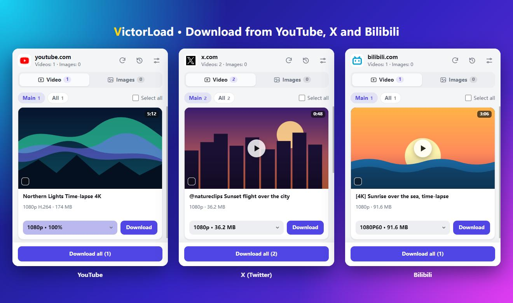

# VictorLoad

<b>Download videos from YouTube, X (Twitter) and Bilibili, in the quality you pick.</b> 
A Chrome extension that also finds HLS streams, MP4s and images on other sites.

  <a href="https://github.com/Victor-Go/VictorLoad/releases/latest"><b>Download the latest release</b></a> ·
  <a href="docs/SITES.en.md">How each site works</a> ·
  <a href="README.zh-CN.md">简体中文</a>

  
  
  

The side panel with demo content.

## Download from YouTube, X and Bilibili

Open a page, and the videos on it show up in the side panel. Pick a quality, press **Download**. No copy-pasting links, no extra website.

| | What you get | How |
| --- | --- | --- |
| **YouTube** | **Up to 1080p with audio and video in one MP4**. Pick the quality in the player; the card shows the buffer progress | Captures the media segments loaded by the player. **Auto download** seeks to missing parts, buffers them and saves |
| **X (Twitter)** | **Every quality** of a tweet's video, GIFs, and images at **original size** | Reads the mp4 variants the page already received. Works in the timeline, on tweet pages and in replies |
| **Bilibili** | Available MP4 qualities (signing in to bilibili.com may add more options) | Uses the same playback data as the web player; one entry per quality |

Details, limits and tips for each site: [docs/SITES.en.md](docs/SITES.en.md).

## Other sites

HLS (`.m3u8`) streams and MP4/WebM files are picked up as the page plays them. If a stream offers several resolutions you can choose one, and the segments are merged for you and saved as an MP4 (AES-128 is supported).

Images appear in a preview grid.

The list is live: new items appear as they load and disappear when they leave the page. You can select several items or download them all, and every item has a preview.

## Other features

- Pick the pictures you care about once, and next time that kind of content is pre-selected on the same site.
- A history list, and a small green check on items you have already downloaded.
- File names can be built from `{tab}`, `{name}`, `{duration}` and `{resolution}`.
- You can change what counts as a "main" image or video.
- Side panel or popup, English, Français, 简体中文 or 繁體中文, light and dark.

## Install

VictorLoad is installed from a release file.

Download `VictorLoad-vX.Y.Z.zip` from the [latest release](https://github.com/Victor-Go/VictorLoad/releases/latest) and unzip it into a folder you will keep. The browser loads the extension from that folder, so don't move or delete it afterwards.

### Chrome

1. Open `chrome://extensions` (or the menu ⋮ → **Extensions** → **Manage Extensions**).
2. Turn on **Developer mode** (top right).
3. Click **Load unpacked** and choose the folder that contains `manifest.json`.
4. Click the puzzle-piece button in the toolbar and pin VictorLoad with the pin icon.

Needs Chrome 116 or newer. Chrome may show a "Disable developer mode extensions" warning when it starts; close it without disabling VictorLoad. More on this in Google's guide: [Load an unpacked extension](https://developer.chrome.com/docs/extensions/get-started/tutorial/hello-world#load-unpacked).

### Microsoft Edge

1. Click the **Extensions** (puzzle-piece) button in the toolbar and choose **Manage extensions**, or open `edge://extensions`.
2. Turn on the **Developer mode** toggle.
3. Click **Load unpacked**, choose the folder that contains `manifest.json`, then click **Select Folder**.
4. Open the **Extensions** menu again and click the eye icon next to VictorLoad to show it in the toolbar.

Needs Edge 116 or newer. Microsoft describes the same steps in [Sideload an extension](https://learn.microsoft.com/en-us/microsoft-edge/extensions/getting-started/extension-sideloading).

### Other Chromium browsers

Brave, Vivaldi, Opera and the like work the same way as Chrome. Open their extensions page (`brave://extensions`, `vivaldi://extensions`, `opera://extensions`), turn on developer mode and load the folder.

### Updating

Download the new zip and unzip it over the same folder, replacing the old files. Then reload the extension: in Chrome click the circular arrow on VictorLoad's card in `chrome://extensions`; in Edge click **Reload** on its card in `edge://extensions`. Finally refresh the tabs that are already open (YouTube needs this).

## How to use

1. Open a page that has a video or images.
2. Click the VictorLoad icon in the toolbar.
   - **Chrome**: a side panel opens on the right of the window and stays open while you switch tabs.
   - **Edge**: the panel opens in Edge's sidebar on the right.
   - If your browser has no side panel, VictorLoad opens as a popup instead. You can also choose side panel or popup yourself in Settings.
3. **Video** tab: every video on the page is listed. Choose a quality in the dropdown and press **Download**. To get several at once, tick their boxes and press **Download selected**, or press **Download all**.
4. **Images** tab: "Main" shows images that match your filters or previous selections (images that fail to load are left out); "All" shows every detected image. Tick the ones you want and press **Download selected**.
5. On YouTube, play the video for a few seconds first. The dropdown shows how much is buffered. At 100% the button says **Download**; below that it says **Auto download**, which buffers the rest and then saves. Pick the quality in YouTube's own player before you start.
6. Files go to `Downloads/VictorLoad/<site>/` by default; Settings lets you change the folder with `{site}`, `{date}`, `{year}` and `{month}` placeholders. YouTube files are saved by the page, straight into your Downloads folder.

The icons at the top of the panel scan the page again, open download history and open Settings (filters, file name format, language).

The interface language is **Auto** by default and follows the browser: Simplified Chinese (mainland China, Singapore, `zh-Hans`), Traditional Chinese (Taiwan, Hong Kong, Macau, `zh-Hant`) and French are used when the browser matches, and every other language falls back to English. To pick one yourself, open Settings → Language and choose from the list.

Settings → Display mode switches between the side panel and the popup. The change applies immediately: the current view closes and the other one opens (older Chrome versions may need one click on the toolbar icon).

## FAQ

**Can I just drag the downloaded file into the browser?**

No. Unzip the release file first, then use **Load unpacked** and select the folder containing `manifest.json`, as described under Install.

**Is it free? Does it collect anything?**

Free and open source (MIT). There is no backend service, and no usage data is sent to the developer. Downloads and previews request media from the original sites; see the [privacy policy](PRIVACY.en.md).

**Can it download 4K from YouTube?**

By default it records H.264 streams (up to 1080p) so audio and video merge into one MP4. Turn that option off in Settings to capture VP9 / AV1 qualities offered by the player, including 4K where available; audio and video are then saved as two files.

**What if a site stops working?**

Check the [limitations](docs/SITES.en.md#limitations) first. If your problem is not listed, open an [issue](https://github.com/Victor-Go/VictorLoad/issues) with the page address and what the side panel shows.

## Please download responsibly

VictorLoad is a tool; what you do with it is up to you. Download only what you have the right to keep, such as your own uploads, content under a licence that allows it, or personal copies where the law and the site's terms allow. DRM-protected video is not supported. Respect creators and each site's terms of service.

## More

- [How each site works, limits and tips](docs/SITES.en.md)
- [Privacy policy](PRIVACY.en.md) · [License](LICENSE) · [Third-party notices](THIRD_PARTY_NOTICES.md)
- [Developing and testing](docs/DEVELOPMENT.md) · [Releasing](docs/RELEASING.md) · [Changelog](CHANGELOG.md)
