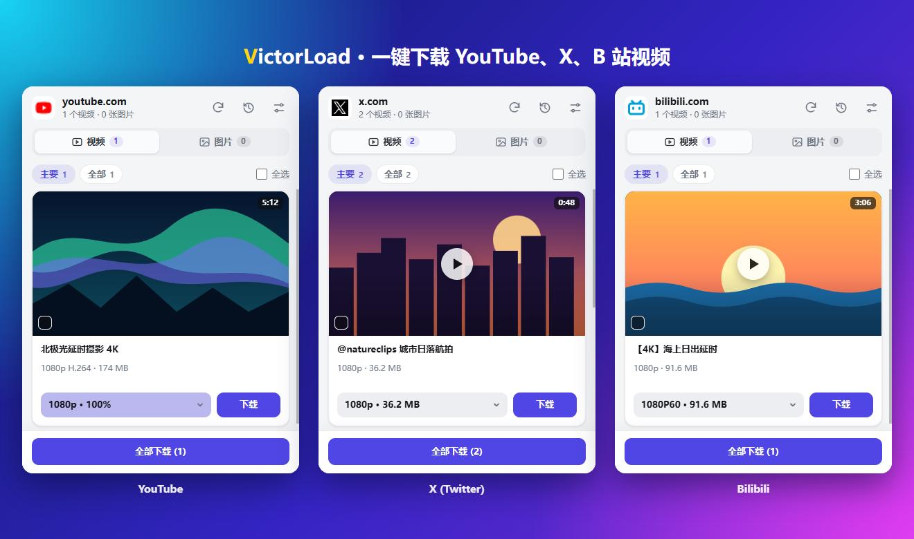

# VictorLoad

<b>一键下载 YouTube、X（推特）、B 站视频，清晰度自己选。</b> 
一个 Chrome 扩展，也能嗅探其他网页上的 HLS 流、MP4 和图片。

  <a href="https://github.com/Victor-Go/VictorLoad/releases/latest"><b>下载最新版本</b></a> ·
  <a href="docs/SITES.md">各站点原理与说明</a> ·
  <a href="README.md">English</a>

  
  
  

侧边栏（演示内容）。

## 下载 YouTube、X、B 站

打开页面，页面上的视频就出现在侧边栏里。选好清晰度，点「下载」。不用复制链接，也不用打开别的网站。

| | 你能得到什么 | 原理 |
| --- | --- | --- |
| **YouTube** | **最高 1080p，音视频合成一个 MP4**。在播放器里选清晰度，卡片上会显示缓冲进度 | 记录播放器加载的媒体分片。有缺口时，「自动下载」会跳到缺口处补全，再保存 |
| **X（推特）** | 一条推文视频的**每一档清晰度**、GIF，以及**原图尺寸**的图片 | 读取页面已经收到的 mp4 各档地址。时间线、推文页、回复里都能用 |
| **B 站** | 列出可用的 MP4 清晰度（登录 bilibili.com 后可能有更多选项） | 使用和网页播放器相同的播放地址数据，每档一项 |

每个站点的细节、限制和小技巧见 [docs/SITES.md](docs/SITES.md)。

## 其他网站

HLS（`.m3u8`）流和 MP4/WebM 文件会在页面播放时自动发现。流里有多档分辨率时可以自己选，分片会自动合并并保存为 MP4（支持 AES-128）。

图片以带预览的网格显示。

列表是实时的：新内容一加载就出现，离开页面就消失。可以多选，也可以全部下载，每一项都有预览。

## 其他功能

- 挑一次想要的图片，下次在同一个网站，同类内容会自动勾选。
- 有下载记录，已经下载过的内容上会显示绿色小对勾。
- 文件名可以用 `{title}`、`{tab}`、`{name}`、`{duration}`、`{resolution}` 组合。
- 「主要」图片和视频的判定标准都可以改。
- 侧边栏或浮窗，简体中文、繁體中文、English 或 Français，浅色和深色。

## 安装

VictorLoad 通过发布包安装。

从[最新发布](https://github.com/Victor-Go/VictorLoad/releases/latest)下载 `VictorLoad-vX.Y.Z.zip`，解压到一个你会长期保留的文件夹。浏览器是从这个文件夹加载扩展的，所以之后不要移动或删除它。

### Chrome

1. 打开 `chrome://extensions`（或菜单 ⋮ → **扩展程序** → **管理扩展程序**）。
2. 打开右上角的**开发者模式**。
3. 点**加载已解压的扩展程序**（Load unpacked），选择包含 `manifest.json` 的文件夹。
4. 点工具栏上的拼图按钮，用图钉图标把 VictorLoad 固定到工具栏。

需要 Chrome 116 或更新版本。Chrome 启动时可能弹出「停用开发者模式的扩展程序」的提示，关掉它即可，不要停用 VictorLoad。更多说明见谷歌的指南：[Load an unpacked extension](https://developer.chrome.com/docs/extensions/get-started/tutorial/hello-world#load-unpacked)。

### Microsoft Edge

1. 点工具栏上的**扩展**（拼图）按钮，选择**管理扩展**，或者直接打开 `edge://extensions`。
2. 打开**开发人员模式**开关。
3. 点**加载解压缩的扩展**（Load unpacked），选择包含 `manifest.json` 的文件夹，再点**选择文件夹**。
4. 再次打开**扩展**菜单，点 VictorLoad 旁边的眼睛图标，把它显示在工具栏上。

需要 Edge 116 或更新版本。微软对同样的步骤有说明：[Sideload an extension](https://learn.microsoft.com/en-us/microsoft-edge/extensions/getting-started/extension-sideloading)。

### 其他 Chromium 内核浏览器

Brave、Vivaldi、Opera 等的做法和 Chrome 一样：打开它们的扩展页面（`brave://extensions`、`vivaldi://extensions`、`opera://extensions`），打开开发者模式，加载文件夹。

### 更新

下载新的 zip，解压到同一个文件夹，覆盖旧文件。然后重新加载扩展：Chrome 里在 `chrome://extensions` 点 VictorLoad 卡片上的圆形箭头；Edge 里在 `edge://extensions` 点它卡片上的**重新加载**。最后刷新已经打开的标签页（YouTube 必须刷新）。

## 使用方法

1. 打开一个有视频或图片的页面。
2. 点工具栏上的 VictorLoad 图标。
   - **Chrome**：窗口右侧会打开侧边栏，切换标签页时它一直都在。
   - **Edge**：面板会在 Edge 右侧的边栏里打开。
   - 如果浏览器没有侧边栏功能，VictorLoad 会改用弹窗。你也可以在设置里自己选侧边栏还是弹窗。
3. **视频**选项卡：页面上的每个视频都会列出来。在下拉框里选清晰度，点**下载**。想一次下载几个，勾选它们再点**下载选中**，或者点**全部下载**。
4. **图片**选项卡：「主要」列出符合筛选条件或之前选择的图片（加载失败的图片不会出现在这里），「全部」列出所有检测到的图片。勾选想要的，点**下载选中**。
5. 在 YouTube 上，先播放几秒视频。下拉框里会显示已缓冲的比例。到 100% 时按钮是**下载**；不到时是**自动下载**，它会补全缺的部分再保存。清晰度请先在 YouTube 自己的播放器里选好。
6. 文件默认保存在 `下载/VictorLoad/<站点>/`，可在设置里用 `{site}`、`{date}`、`{year}`、`{month}` 自定义文件夹。YouTube 的文件由页面保存，直接进下载文件夹。

面板顶部的几个图标分别是：重新嗅探当前页面、打开下载记录、打开设置（过滤、文件名格式、语言）。

界面语言默认是「自动」，跟随浏览器：简体中文（中国大陆、新加坡等）、繁体中文（台湾、香港、澳门及 `zh-Hant`）和法文会匹配显示，其他语言一律回退到英文。想固定语言，在设置的「语言 / Language」下拉框里选择即可。

设置里的「显示方式」可以在侧边栏和浮窗之间切换，切换后立即生效：当前界面会关闭并打开另一种（较旧的 Chrome 可能需要再点一次工具栏图标）。

## 常见问题

**能直接把下载的文件拖进浏览器安装吗？**

不能。先解压发布包，再按上面的步骤「加载已解压的扩展程序」，选择包含 `manifest.json` 的文件夹。

**免费吗？会收集数据吗？**

免费开源（MIT）。没有后端服务，也不向开发者发送使用数据。下载和预览需要向原站点请求媒体，详见[隐私政策](PRIVACY.md)。

**能下载 YouTube 的 4K 吗？**

默认记录 H.264 流（最高 1080p），这样音频和视频能合成一个 MP4。在设置里关掉这个选项，可以记录播放器提供的 VP9 / AV1 清晰度，包括可用的 4K，但音频和视频会保存成两个文件。

**某个网站不好用了，怎么办？**

先查看[限制说明](docs/SITES.md#限制)。如果没有对应说明，请提一个 [issue](https://github.com/Victor-Go/VictorLoad/issues)，附上页面地址和侧边栏显示的内容。

## 请负责任地下载

VictorLoad 只是工具，怎么用由你决定。请只下载你有权保存的内容，比如你自己上传的、授权允许的，或在法律和网站条款允许范围内的个人备份。不支持带 DRM 的视频。请尊重创作者和各站点的服务条款。

## 更多

- [各站点原理、限制与技巧](docs/SITES.md)
- [隐私政策](PRIVACY.md) · [许可证](LICENSE) · [第三方声明](THIRD_PARTY_NOTICES.md)
- [开发与测试](docs/DEVELOPMENT.md) · [发布流程](docs/RELEASING.md) · [更新日志](CHANGELOG.md)
